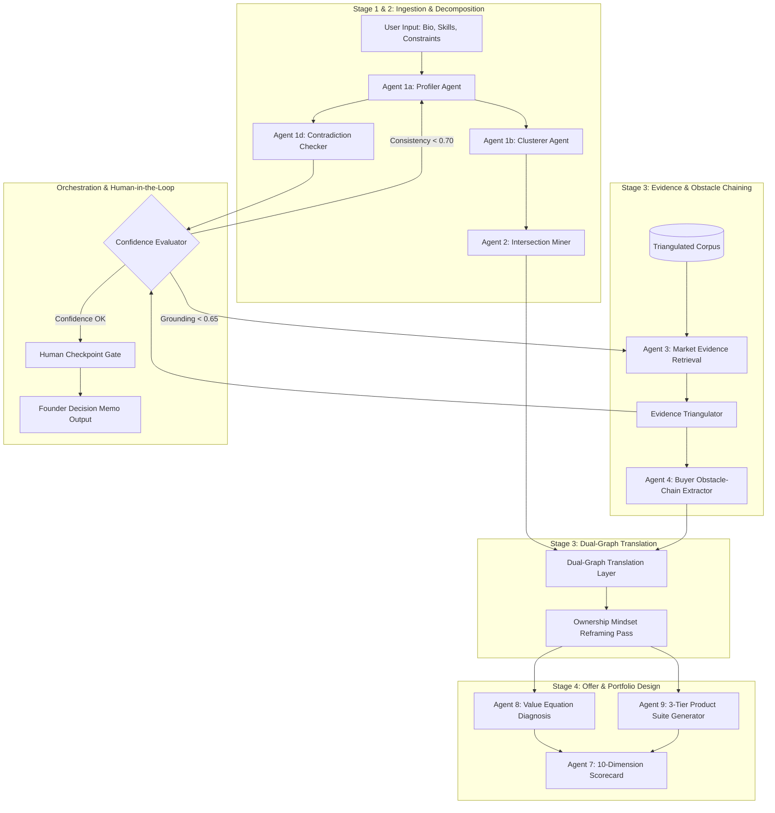

# System Architecture & Technical Design
## Agentic Entrepreneur OS (FYP-I)

## 1. High-Level Architectural Diagram

---

## 2. Component Design & Responsibilities

### 2.1 Capability Decomposition Subsystem
- **ProfilerAgent:** Normalizes raw profile strings into typed Pydantic models. Extracts capabilities, context, and financial/temporal limits.
- **ClustererAgent:** Uses categorical and semantic similarity to group individual skills into functional capability domains (Engineering, Data, Automation, AI/NLP, Compliance).
- **IntersectionMinerAgent:** Calculates $N \times (N-1) / 2$ intersections between clusters. Synthesizes high-leverage combinations (e.g. Automation + Compliance = Automated Audit Packs).
- **ContradictionCheckerAgent:** Applies rule-based heuristics to verify feasibility. Flags unrealistic timelines or underfunded ventures.

### 2.2 Evidence & Obstacle Chaining Subsystem
- **CorpusLoader:** In-memory indexed store of real-world buyer pain points.
- **EvidenceTriangulator:** Validates that each outcome category is corroborated by at least two distinct source types:
  - *Forums:* Unfiltered buyer venting and bug descriptions.
  - *Reviews:* Quantitative satisfaction scores and missing feature complaints.
  - *Job Postings:* Commercial willingness to pay for contractor solutions.
  - *Industry Reports:* Macro economic loss and organizational friction metrics.
- **BuyerObstacleChainExtractor:** Chronologically sequences buyer friction into three distinct journey phases:
  - Phase 1: `BEFORE_ATTEMPT` (Search cost, pricing anxiety)
  - Phase 2: `DURING_EXECUTION` (Integration failures, schema bugs)
  - Phase 3: `AFTER_COMPLETION` (Maintenance debt, compliance exposure)

### 2.3 Dual-Graph Translation & Reframing
- **DualGraphTranslationLayer:** Implemented using `networkx.DiGraph`.
  - Subgraph 1: $G_{cap} = (V_{cap}, E_{cap})$ representing clusters, skills, and synergies.
  - Subgraph 2: $G_{buyer} = (V_{buyer}, E_{buyer})$ representing sequential obstacle progressions.
  - Bipartite Bridge: Causal mechanism edges $E_{causal} \subseteq V_{cap} \times V_{buyer}$ representing how technical capability relieves buyer pain.
- **OwnershipMindsetReframer:** Converts linear, additive labor statements into scalable, compounding asset statements (Power 4, Bouchaud & Mézard [11], Penrose [16]).

### 2.4 Offer Diagnosis & Funnel Subsystem
- **OfferDiagnosisAgent:** Operationalizes Alex Hormozi's Value Equation:
  $$V = \frac{\text{Dream Outcome} \times \text{Perceived Likelihood}}{\text{Time Delay} \times \text{Effort \& Sacrifice}}$$
  Identifies the bounding parameter and generates concrete remediation actions.
- **ProductSuiteGenerationAgent:** Formulates a 3-tier product suite:
  - *Tier 1: Free Lead Magnet* (Maximizes opportunity surface area, Pluchino et al. [12]).
  - *Tier 2: Core Productized Offer* (High-ticket setup, $1,500 - $3,500).
  - *Tier 3: Compounding Backend Retainer* (Recurring maintenance / SRE, $399 - $599/mo).

### 2.5 Orchestration & Confidence Routing
- **ConfidenceEvaluator:** Evaluates grounding and consistency signals:
  $$\text{Grounding} = 0.5 \times \text{Triangulation Ratio} + 0.5 \times \text{Obstacle Coverage}$$
  $$\text{Consistency} = 1.0 - \sum \text{Contradiction Penalties}$$
  Automatically triggers loop-backs if thresholds ($\text{Grounding} \ge 0.65$, $\text{Consistency} \ge 0.70$) are violated.
- **HumanCheckpointManager:** Gating mechanism presenting key assumptions and regret-minimization framing (Power 1) before external commitment.
